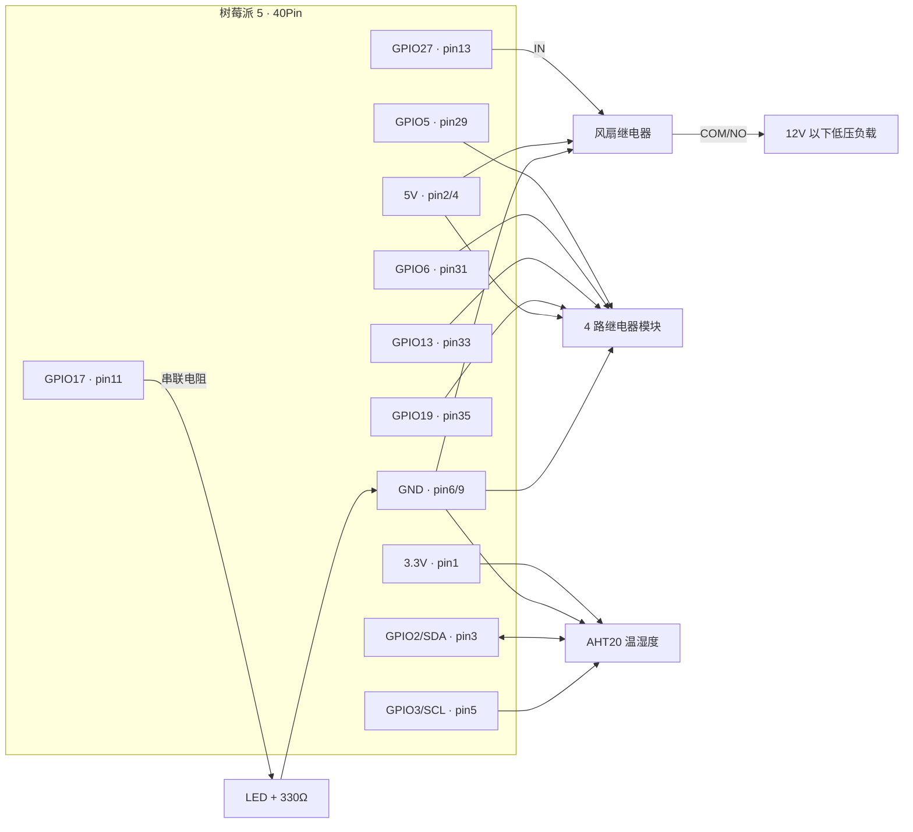

# 设备 MCP Server（分工4 · 硬件适配组）

> 把树莓派上的 LED、风扇、继电器、温湿度传感器封装成 **MCP 工具**，
> 由分工3 的 Agent 通过 **stdio** 拉起并自动发现；Agent 对具体硬件零感知。

本目录是分工4 的交付物：**设备 MCP Server + 接线/引脚文档 + 工具清单 + 自检脚本**。
工具契约见 [`docs/接口文档/mcp_tools_schema.md`](../docs/接口文档/mcp_tools_schema.md)，
MCP 原理与实现说明见 [`docs/分工4-MCP搭建说明.md`](../docs/分工4-MCP搭建说明.md)。

## 1. 文件说明

| 文件 | 作用 |
| --- | --- |
| `device_mcp_server.py` | **正式交付**：真机 GPIO 实现 + 无硬件自动仿真 |
| `mcp_selftest.py` | 契约自检：真跑一遍 MCP 握手/工具发现/调用，32 项断言 |
| `mock_mcp_server.py` | 分工4 早期 mock（保留作对照，联调已改用正式版） |
| `requirements.txt` | 设备侧依赖（mcp / gpiozero / smbus2） |

## 2. 它是什么（30 秒版）

MCP（Model Context Protocol）是 Agent 与外部能力之间的标准接口。可以把设备 Server 想成
**“硬件驱动 + 说明书”**：它向 Agent 登记“我有哪些工具、参数是什么、返回什么”，
Agent 只按这份清单调用，完全不需要知道背后是 GPIO 还是别的东西。

```
Agent（分工3） ──MCP/JSON-RPC over stdio──> device_mcp_server.py ──GPIO/I2C──> 物理设备
                 tools/list  ← 工具清单（自动生成 JSON Schema）
                 tools/call  → 真正执行
```

因此：**加一个新设备 = 在 Server 里加一个 `@mcp.tool`**，Agent 代码一行都不用改。

## 3. 快速验证（没有树莓派也能跑）

在电脑上（Windows / macOS / Linux 均可）：

```bash
python3 -m venv .venv
.venv/bin/pip install -r devices/requirements.txt      # Windows: .venv\Scripts\pip

# 强制仿真模式跑契约自检：会真的走 MCP 协议拉起子进程
python devices/mcp_selftest.py --sim
```

期望结果：

```
== 结果: 32 通过, 0 失败 ==
```

自检覆盖：`initialize` 握手 → `tools/list` 工具发现 → 参数 schema 与契约逐项比对 →
`led/fan/relay/dht/status` 实际调用 → 越界与错误类型被拒绝 → 未知工具返回协议错误。

> 直接运行 `python device_mcp_server.py --sim` 看起来会“卡住”，这是正常的：
> stdio Server 在等 Agent 发 JSON-RPC 消息，必须由 Agent 或自检脚本拉起。

## 4. 树莓派部署

```bash
# ① 系统依赖与 I2C（AHT20 需要；只用 LED/继电器可跳过 raspi-config）
sudo apt update && sudo apt install -y python3-venv i2c-tools
sudo raspi-config          # Interface Options → I2C → Enable，然后重启
i2cdetect -y 1             # 应能看到 0x38（AHT20）

# ② 依赖（装进 Agent 使用的 venv，避免两套环境）
cd /opt/piagent
python3 -m venv agent/.venv                      # 若 Agent 已部署可跳过
agent/.venv/bin/pip install -r agent/requirements.txt -r devices/requirements.txt

# ③ 真机自检（会真实动作，先确认接线无误、负载是低压）
agent/.venv/bin/python devices/mcp_selftest.py --gpio
#    还没接温湿度/继电器时，可先跳过对应项（跳过的项不算失败）：
agent/.venv/bin/python devices/mcp_selftest.py --gpio --skip-dht --skip-relay
```

自检通过时会打印 `✅ 真机验收通过`，并且状态快照里是 `"mode": "gpio"`；
如果显示 `"mode": "sim"`，说明跑的是仿真，**没有真正驱动 GPIO**。

真机自检会依次点亮/熄灭 LED、开/关风扇、闭合继电器 0 号通道、读一次温湿度。
**第一次上电请只接 LED，确认无误后再接继电器和负载。**

## 5. 接线图与引脚对照表

默认引脚（BCM 编号）全部可在环境变量里改，见 §6。

| 设备 | 信号 | BCM | 物理引脚 | 电源 / 地 | 说明 |
| --- | --- | --- | --- | --- | --- |
| LED（含 330Ω 电阻） | 阳极 | **GPIO17** | 11 | 阴极 → GND（pin 9） | GPIO17 → 330Ω → LED 长脚，短脚接 GND |
| 风扇继电器 IN | 控制 | **GPIO27** | 13 | 继电器 VCC→5V(pin 2/4)、GND→pin 6 | 风扇走继电器 COM/NO，电源独立 5V |
| 继电器模块 CH0 | IN1 | **GPIO5** | 29 | 模块 VCC→5V、GND→GND | 低电平触发模块见 §6 |
| 继电器模块 CH1 | IN2 | **GPIO6** | 31 | 同上 | |
| 继电器模块 CH2 | IN3 | **GPIO13** | 33 | 同上 | |
| 继电器模块 CH3 | IN4 | **GPIO19** | 35 | 同上 | |
| AHT20 温湿度 | SDA | **GPIO2** | 3 | VCC→3.3V(pin 1)、GND→pin 9 | I2C-1，地址 0x38 |
| AHT20 温湿度 | SCL | **GPIO3** | 5 | 同上 | 需先开启 I2C |



### 电气安全红线（务必遵守）

1. **GPIO 只接受 3.3V 电平**，5V 信号必须分压（如 HC-SR04 的 Echo 用 1kΩ+2kΩ 分压）；
2. **所有模块必须共地**，否则控制信号没有参考电平；
3. 继电器/风扇使用**独立电源**，不要从树莓派 5V 引脚直接带大电流负载；
4. 继电器只接 **12V 以下低压负载**，感性负载（风扇/电机）在负载侧加**续流二极管**；
5. **全程不碰 220V**；演示前断电接线，确认无误再上电；
6. 舵机（SG90）若使用，必须独立 5V 供电并共地，不要从 GPIO 取电。

## 6. 配置（环境变量）

在 `agent/config.toml` 的 `[[mcp.servers]]` 里用 `env = { ... }` 传给子进程，
也可以写进 systemd 的 `Environment=`。

| 变量 | 默认值 | 说明 |
| --- | --- | --- |
| `PIAGENT_MCP_SIM` | 自动 | `1` 强制仿真、`0` 强制真机；不设置时：非 Linux 或没有 gpiozero 则仿真 |
| `PIAGENT_LED_PIN` | `17` | LED 的 BCM 引脚 |
| `PIAGENT_FAN_PIN` | `27` | 风扇控制引脚 |
| `PIAGENT_RELAY_PINS` | `5,6,13,19` | 继电器通道 0-3 对应的 BCM 引脚，逗号分隔 |
| `PIAGENT_ACTIVE_HIGH` | `1` | LED/风扇高电平有效；低电平点亮接法设 `0` |
| `PIAGENT_RELAY_ACTIVE_HIGH` | `1` | 继电器高电平触发；**低电平触发模块设 `0`** |
| `PIAGENT_DHT_BACKEND` | `aht20` | 温湿度后端：`aht20` / `none` |
| `PIAGENT_DHT_BUS` | `1` | I2C 总线号 |
| `PIAGENT_DHT_ADDR` | `0x38` | AHT20 地址（十进制或 `0x` 十六进制） |
| `PIAGENT_LOG_LEVEL` | `INFO` | `DEBUG` / `INFO` / `WARNING`（日志只写 stderr） |

> 引脚改动后无需改代码；`relay.set` 的通道上限会随 `PIAGENT_RELAY_PINS` 自动变化。
> 某个引脚接错只会在 `devices.status` 的 `errors` 里报告，并禁用该设备，不会拖垮整个 Server。

## 7. 工具清单（对 Agent 暴露的能力）

| 工具 | 参数 | 成功返回 | 高危 |
| --- | --- | --- | --- |
| `led.set` | `on: bool` | `{"ok":true,"led":true,"detail":"LED 已点亮"}` | |
| `fan.set` | `state: bool` | `{"ok":true,"fan":true,"detail":"风扇已打开"}` | |
| `relay.set` | `ch: int(0-3), state: bool` | `{"ok":true,"ch":0,"state":true,"detail":...}` | ⚠️ 是 |
| `dht.read` | 无 | `{"ok":true,"temp":26.4,"hum":58.2}` | |
| `devices.status` | 无 | 状态快照 + `mode`/`pins`/`errors` | |

约定（契约 §2）：

- 工具名 `<设备>.<动作>`，参数用 Python 类型标注，SDK 自动生成 JSON Schema；
- 返回**永远是 JSON 字符串**：成功带 `"ok": true`，失败 `{"ok": false, "error": "原因"}`；
- 工具内不联网、不长时间阻塞；stdout 归协议，日志一律 stderr；
- `relay.set` 在 Agent 的 `confirm_tools` 名单里：聊天指令永远不执行，只有手动控制台
  `confirmed=true` 才放行（安全闸门在分工3 的 `safety.py`，本 Server 只做通道越界校验）。

## 8. 接入 Agent（与分工3 联调）

编辑 `agent/config.toml`（没有就从 `config.example.toml` 复制）：

```toml
[[mcp.servers]]
name = "devices"
command = "/opt/piagent/agent/.venv/bin/python"          # 必须写绝对路径
args = ["/opt/piagent/devices/device_mcp_server.py"]
# env = { PIAGENT_MCP_SIM = "0", PIAGENT_RELAY_ACTIVE_HIGH = "0" }
```

重启 Agent 后，日志里应出现：

```
MCP server 'devices' 已启动，工具: ['led.set', 'fan.set', 'relay.set', 'dht.read', 'devices.status']
注册成功，工具能力已上报: [...]
```

然后在网关的调试控制台点按钮，或对 Agent 说“把风扇打开”，即可驱动真实硬件。

**切换 mock / 真机只改这一行 `args`**：mock 是 `mock_mcp_server.py`，真机是
`device_mcp_server.py`。Agent 与上层完全不用改。

## 9. 排障

| 现象 | 原因 / 处理 |
| --- | --- |
| Agent 日志没有工具 | 路径/解释器不对；先在树莓派手动跑 `agent/.venv/bin/python devices/mcp_selftest.py --gpio` |
| `ModuleNotFoundError: mcp` | 用错了解释器：`command` 必须是装过依赖的 venv python 绝对路径 |
| `GPIO 初始化失败` / `PermissionError` | 检查接线、`/dev/gpiochip*` 权限；先用 `--sim` 验证协议链路 |
| `dht.read` 返回错误 | I2C 未开启、地址不对（`i2cdetect -y 1` 看不到 0x38）或传感器没接 |
| 继电器动作相反 | 模块是低电平触发：`PIAGENT_RELAY_ACTIVE_HIGH=0` |
| 上电瞬间继电器“啪”一下 | 初始化时已默认输出低电平；仍有抖动可换用带光耦隔离的模块 |
| 工具调用超时 | 检查是否在工具里阻塞过久；AHT20 单次读取约 80ms，属正常 |

## 10. 验收清单（分工4 DoD）

- [x] `python devices/mcp_selftest.py --sim` 全绿（32/32，已验证）
- [x] 工具名/参数/返回与 `docs/接口文档/mcp_tools_schema.md` 一致（自检逐项比对）
- [x] 分工3 的 `MCPPool` 能零改动拉起本 Server 并列出/调用工具（已验证）
- [x] 接线图、引脚对照表、环境变量、排障文档齐全（本文）
- [ ] 树莓派真机接线后 `--gpio` 自检全绿（上板后补做）
- [ ] `scripts/e2e_test.py` 对真机全绿（需要 VPS 与账号，部署后补做）

## 11. 扩展新设备（示例：有源蜂鸣器）

在 `device_mcp_server.py` 里加一个工具即可，Agent 下次启动自动发现：

```python
# ① GpioBackend.__init__ 里加一行（_make 负责故障隔离）：
self._buzzer = self._make("buzzer", lambda: Buzzer(22))

# ② 两个后端各加一个同名方法（SimBackend 可用 sleep 模拟，仿真也能联调）：
def beep(self, ms: int) -> None:
    self._buzzer.beep(on_time=ms / 1000, n=1, background=False)

# ③ 模块级注册工具：
@mcp.tool(name="buzzer.beep", description="让有源蜂鸣器响 ms 毫秒（10-3000）。")
def buzzer_beep(ms: int = 200) -> str:
    if not 10 <= ms <= 3000:
        return _err("参数 ms 需在 10-3000 之间")
    try:
        with _LOCK:
            _hw().beep(ms)
        log.info("蜂鸣 %sms", ms)
        return _ok(detail=f"蜂鸣 {ms}ms")
    except Exception as e:  # noqa: BLE001
        return _err(f"蜂鸣器控制失败: {e}")
```

舵机（SG90）注意：Pi 5 上舵机 PWM 需要额外处理——`gpiozero.Servo` 依赖 pigpio，
而 pigpio 对 Pi 5 的支持有限，lgpio 后端也不直接提供舵机所需 PWM。可改用
`lgpio.tx_pwm` 软件 PWM 或外接 PWM 驱动板；建议作为进阶项，先把 LED/风扇/继电器/温湿度跑稳。
