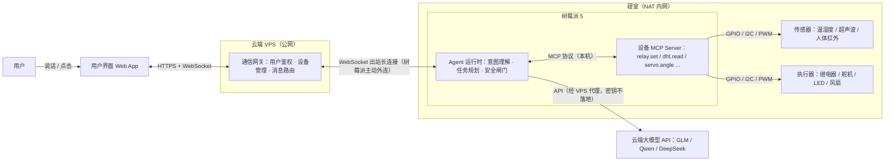

# PiAgent：基于树莓派的 AI Agent 物联网控制平台

> 创客课程设计 · 项目介绍文档 v0.1 · 2026-10

## 1. 一句话介绍

我们在树莓派上部署一个 AI Agent，把继电器、传感器等物理设备封装成 MCP 工具；用户在任何地方对它说一句"把风扇打开"，指令经云端 VPS 中继送达树莓派，由 Agent 自主理解并驱动真实硬件——**让大模型从"会聊天"变成"会动手"**。

**30 秒电梯介绍**：这是一台装在大脑（AI Agent）、长出手脚（传感器与执行器）、还带远程神经（VPS 通信中继）的树莓派。你在千里之外用手机说一句话，寝室里的灯就亮了——中间没有人工点击，只有 Agent 自己思考、自己调用工具、自己动手。

## 2. 背景与价值

**我们要解决的问题**

- 寝室/家中的硬件设备都藏在 NAT 后面的内网里，人不在现场就摸不到；
- 传统智能家居 App 各自为战、场景固定，无法用自然语言自由组合指令；
- 想体验"AI 操控物理世界"，缺少一套低成本、可拆解、适合学习全链路的实验平台。

**我们的方案**：一台树莓派 5 + 一个 Agent + 一台云 VPS，四个模块全部自研。

**项目亮点**

1. **自然语言操作物理世界**：LLM Agent 负责理解与规划，用户不需要任何"遥控器"；
2. **MCP 标准化设备接入**：每类设备就是一组工具（tool），加设备 = 加一个工具，即插即用，Agent 代码零改动；
3. **VPS 出站长连接**：树莓派主动向外连接，天然穿透 NAT / 校园网，无需公网 IP；
4. **模块边界清晰**：四个模块通过接口契约解耦，可四线并行开发，本身就是一次完整的工程协作训练。

## 3. 系统总体架构



**四条边界，四个模块**：界面（用户 ⇄ 系统）、通信（用户侧 ⇄ 树莓派侧）、Agent（指令 ⇄ 工具调用）、设备（软件 ⇄ 硬件）。

## 4. 一次指令的完整旅程

以用户说"我快热死了，把风扇打开"为例：

1. 用户在手机界面输入（或语音转文字）；
2. 界面通过 WSS 把消息发给 VPS；
3. VPS 校验用户身份，找到其绑定的、当前在线的树莓派，转发指令；
4. 树莓派上的 Agent 收到文本，连同可用工具清单交给大模型；
5. 大模型决定调用 `relay.set(channel=0, state=true)`；
6. Agent 经 MCP 协议调用设备 Server，Server 驱动 GPIO → 继电器闭合 → 风扇转动；
7. 执行结果沿原路返回：设备 Server → Agent → VPS → 界面，展示"已为你打开风扇"；
8. 传感器数据随心跳周期上报，界面状态面板实时刷新。

## 5. 四大模块详细分工

> 每个模块含：角色定位 / 任务拆解 / 技术选型建议 / 交付物 / 模块边界。

### 模块 A：用户交互界面

**角色定位**：系统的"脸面"，用户唯一入口，演示时评委看到的全部。

**任务拆解**

| 优先级 | 功能 | 说明 |
| --- | --- | --- |
| P0 | 登录鉴权 | 对接 VPS 的账号体系 |
| P0 | 对话页 | 发送自然语言指令；展示 Agent 回复与"正在调用哪个工具"的过程 |
| P0 | 设备面板 | 树莓派在线状态、传感器实时读数（温度/湿度等） |
| P0 | 手动控制台 | 绕过 Agent 直接开关设备——既是兜底，也是联调利器 |
| P1 | 历史日志 | 指令与执行记录 |
| P1 | 演示模式 | 扫码临时授权，方便评委/同学体验 |

**技术选型建议**：响应式 **Web App（Vue3 / React）**。理由：手机浏览器即开即用、免上架、跨平台、开发快；做成 PWA 还能"添加到主屏幕"获得类 App 体验。原生 App / 小程序仅在有余力时考虑。

**模块边界**：只与 VPS 通信，**永远不直连树莓派**。

**交付物**：可部署的 Web 应用、部署说明、面向模块 B 的 API 用例集。

### 模块 B：VPS 通信中继

**角色定位**：系统"血管"，同时解决两个核心问题——**远程可达**（树莓派在 NAT 后无公网 IP）与**用户-设备解耦**（多用户、多设备的管理点）。

**核心思路**：树莓派作为客户端**主动向外**建立 WebSocket 长连接。出站流量在任何网络（校园网、家宽、甚至手机热点）都畅通，从而绕过一切入站限制。

**任务拆解**

| 任务 | 说明 |
| --- | --- |
| 用户鉴权 | 账号注册/登录，JWT 签发 |
| 设备管理 | 设备注册、心跳检测、在线状态、用户-设备绑定 |
| 消息路由 | 用户 → 树莓派下发指令；树莓派 → 用户回传结果与遥测 |
| 安全 | 全链路 TLS，设备级 token，指令审计日志 |
| 进阶 | LLM API 出口代理——模型密钥只存 VPS，不落在终端 |

**技术选型（建议分两步走）**

| 方案 | 用途 | 说明 |
| --- | --- | --- |
| frp / SSH 反向隧道 | 第 1 周的快速通道 | 先打通"手机 → VPS → 树莓派"，全组尽早看到端到端希望 |
| **自研 WebSocket 网关（推荐正式方案）** | 正式架构 | Node.js / Go / Python FastAPI 均可；教学价值与演示价值最高 |
| MQTT（EMQX/Mosquitto） | 备选参考 | 成熟的 IoT 协议，可作对照学习 |

**交付物**：网关服务、消息协议文档（见 §6）、部署脚本。

### 模块 C：树莓派 Agent

**角色定位**：系统的"大脑"，把自然语言翻译成硬件动作。

**设计原则：Agent 保持"薄"**。Agent 本体只做三件事——收指令、调度大模型、调工具。一切设备能力都通过 MCP 工具注入，Agent 对具体硬件**零感知**：换设备、加设备都不改 Agent 代码。

**任务拆解**

| 任务 | 说明 |
| --- | --- |
| 通信客户端 | 作为模块 B 协议的客户端，维持长连接、断线重连 |
| Agent 循环 | 意图理解 → 工具调用（MCP）→ 观察结果 → 自然语言汇报 |
| LLM 接入 | 云 API 经 VPS 代理调用（国内可直接用 GLM / Qwen / DeepSeek）；有余力加本地 ollama 小模型作离线彩蛋 |
| 安全闸门 | 工具白名单、参数校验、高危操作（继电器大电流）二次确认 |
| 工程化 | systemd 守护进程，开机自启、崩溃自动拉起 |

**技术选型建议**：Python；MCP 官方 Python SDK（`mcp`）；工具调用循环建议**手写**（真正理解 Agent 原理），框架党可选 LangGraph。

**模块边界**：向上对模块 B 说"消息协议"，向下对模块 D 说"工具清单"。

**交付物**：Agent 守护进程、系统提示词与工具描述文案（这直接决定 Agent 好不好用）。

### 模块 D：物理设备连接与适配

**角色定位**：系统的"手和眼"，软件世界的终点、物理世界的起点。

**任务拆解**

1. **设备选型与采购**（清单见下）；
2. **接线与电气安全**：树莓派 GPIO 为 3.3V 电平；5V 传感器信号需分压；各模块必须共地；继电器只接低压负载；
3. **驱动开发**：`gpiozero`（Pi 5 兼容，底层 lgpio）、`smbus2`（I2C）、`picamera2`（摄像头）。注意：老 `RPi.GPIO` 库**不支持树莓派 5**，不要用；
4. **封装为 MCP Server**：每类设备一组工具，统一注册给 Agent——这是本模块的灵魂产出。

**推荐设备清单**

| 设备 | 接口 | 角色 | 示例 MCP 工具 | 备注 |
| --- | --- | --- | --- | --- |
| LED + 电阻 | GPIO | 执行器 | `led.set(on)` | 入门第一课 |
| 继电器模块 | GPIO | 执行器 | `relay.set(ch, state)` | 只接 12V 以下负载 |
| 12V 风扇 + 继电器 | GPIO | 执行器 | `fan.set(state)` | 主打演示道具 |
| SG90 舵机 | PWM | 执行器 | `servo.set_angle(deg)` | 可做"物理开关拨杆" |
| 有源蜂鸣器 | GPIO | 执行器 | `buzzer.beat(ms)` | 提醒类场景 |
| SSD1306 OLED | I2C | 输出 | `oled.show(text)` | 设备状态屏 |
| AHT20 / DHT22 | I2C / GPIO | 传感器 | `dht.read() → {temp, hum}` | I2C 型号更稳定 |
| HC-SR04 超声波 | GPIO | 传感器 | `sonar.distance()` | Echo 脚 5V，需分压到 3.3V |
| PIR 人体红外 | GPIO | 传感器 | `pir.wait_motion()` | 联动场景 |
| 摄像头模块 | MIPI | 传感器 | `camera.snap()` | 进阶：多模态看图 |

**模块边界**：只对本机 Agent 暴露 MCP 工具，不关心网络与界面。

**交付物**：设备 MCP Server、接线图与引脚对照表、工具清单文档。

## 6. 模块间接口契约（第 1 周必须冻结）

四线并行开发的前提是接口先行。三份契约、四个人、第一周定稿：

| 边界 | 契约内容 | 主导人 |
| --- | --- | --- |
| 界面 ⇄ VPS | REST API（登录/设备列表）+ WS 聊天与推送格式 | A、B |
| 树莓派 ⇄ VPS | 长连接消息协议（见下） | B、C |
| Agent ⇄ 设备 | MCP 工具清单与参数 schema | C、D |

**树莓派 ⇄ VPS 消息协议示例**（JSON，双向同一条连接）：

```jsonc
// Pi → VPS：连接建立后第一条，注册
{ "type": "register", "device_id": "pi-dorm-01", "token": "设备密钥",
  "caps": ["relay", "dht", "servo"] }

// Pi → VPS：心跳（每 15s，可捎带遥测）
{ "type": "heartbeat", "telemetry": { "temp": 26.4, "hum": 58 } }

// VPS → Pi：下发指令
{ "type": "cmd", "id": "c-1024", "payload": { "kind": "chat", "text": "把风扇打开" } }

// Pi → VPS：执行结果（id 对应指令，供路由回正确的用户）
{ "type": "result", "id": "c-1024", "ok": true,
  "text": "已打开风扇", "actions": ["relay.set(0, true)"] }
```

**仓库结构建议**（monorepo，四个模块一个仓库）：

```
raspberry-agent/
├── frontend/   # 模块 A：用户界面
├── server/     # 模块 B：VPS 网关
├── agent/      # 模块 C：树莓派 Agent
├── devices/    # 模块 D：设备 MCP Server + 接线文档
└── docs/       # 接口契约、项目文档
```

## 7. 开发里程碑

| 阶段 | 时间建议 | 目标 | 验收标准 |
| --- | --- | --- | --- |
| M0 接口冻结 | 第 1 周 | 三份接口契约定稿；VPS 到手；frp 隧道跑通 | 手机能经 VPS 访问到树莓派 |
| M1 单模块开发 | 第 2–3 周 | 四模块并行开发，各自 mock 对端 | 每个模块本地能独立演示 |
| M2 两两联调 | 第 4–5 周 | A+B（界面↔网关）、C+D（Agent↔硬件） | 手机聊天能收发；Agent 本机能点灯 |
| M3 全链路打通 | 第 6 周 | 四模块真机集成 | 远程一句话点亮风扇 |
| M4 稳定与演示 | 第 7–8 周 | 断线重连、异常处理、演示脚本、结项文档 | 完整 demo 彩排通过 |

每周固定一次全链路联调会，从 M2 起雷打不动。

## 8. 演示场景设计

1. **千里之外**（主打）：演示者手机关掉 WiFi 只用 4G，一句话让寝室的风扇转起来、灯亮起来——突出"真远程"；
2. **感官延伸**："寝室现在多少度？"——Agent 读传感器后用自然语言回答；
3. **自主决策**："太热了，想办法让我凉快点"——Agent 自己读温度、开风扇、汇报决策过程——这是 Agent 与遥控器的本质区别；
4. **弹性彩蛋**：现场拔掉树莓派网线再插回，界面显示离线 → 在线，期间指令不丢——展示工程可靠性。

## 9. 风险与应对

| 风险 | 影响 | 应对 |
| --- | --- | --- |
| 寝室工作日夜间断电断网 | 设备周期性离线 | systemd 开机自启 + 自动重连；校园网自动认证脚本；VPS 缓存离线指令待补发；进阶可加 UPS HAT |
| 校园网认证账号不够 | 树莓派无法入网 | 架构上只需**出站**流量：手机热点、借道路由器均可，不需要公网 IP，也不占用入站资源 |
| LLM 幻觉 / 误操作 | 硬件误动作 | 工具白名单 + 参数强校验；高危工具二次确认；演示负载全部低压 |
| 电气安全 | 烧板 / 触电 | GPIO 坚持 3.3V 电平；5V 信号分压；共地；**全程不碰 220V** |
| Pi 5 GPIO 库兼容 | 驱动不工作 | 统一用 gpiozero（lgpio 后端），禁用老 RPi.GPIO |
| 四模块集成延期 | 联调爆炸 | 接口契约第一周冻结；mock 先行；每周固定联调 |

## 10. 团队分工总表

| 成员 | 模块 | 一句话职责 | 核心交付物 | 关键协作 |
| --- | --- | --- | --- | --- |
| A | 用户界面 | 系统的脸 | Web App | 与 B 定 API |
| B | VPS 通信 | 系统的血管 | WebSocket 网关 | 与 A 定 API、与 C 定消息协议 |
| C | 树莓派 Agent | 系统的大脑 | Agent 守护进程 | 与 B 定消息协议、与 D 定工具清单 |
| D | 设备适配 | 系统的手和眼 | 设备 MCP Server + 接线文档 | 与 C 定工具清单 |

> 若实际人数少于 4 人：优先合并 A+B（前后端同人）；C 与 D 的接口因 MCP 协议天然解耦，最不易互相阻塞。
